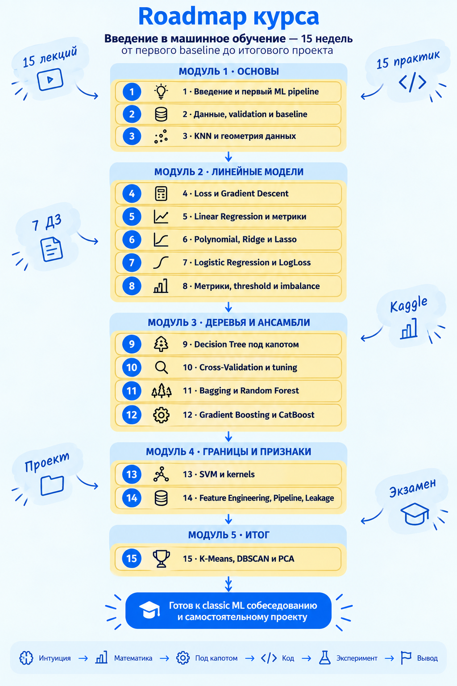

# Введение в машинное обучение

Материалы университетского курса ДГТУ для студентов 3 курса бакалавриата.

Формат курса:

- 15 учебных недель;
- 1 онлайн-лекция и 1 онлайн-практика в неделю;
- основной язык — русский, профессиональная терминология — русская и английская;
- основной стек: Python, NumPy, Pandas, Matplotlib, scikit-learn, CatBoost;
- рабочая среда: локальный Jupyter Notebook, Google Colab как резервный вариант;
- семестровая оценка ставится по рейтингу: опросы и два соревнования Kaggle с защитами.

Главная идея курса: студент должен не только уметь вызвать `fit()` и `predict()`, но и понимать, что модель делает внутри, как проверить качество результата и где может возникнуть ошибка.

## Документы

- [Пара 1: презентация Reveal.js и материалы преподавателя](materials/Пара1/README.md)
- [Пара 2: презентация, методичка и конспект про линейную регрессию](materials/Пара2/README.md)
- [Актуальный сценарий первой пары для преподавателя (PDF)](output/pdf/КОНСПЕКТ_ЛЕКЦИИ.pdf)
- [Краткий учебный план в формате Word](docs/kratkiy_uchebnyy_plan.docx)
- [Краткий учебный план в формате PDF](output/pdf/kratkiy_uchebnyy_plan.pdf)
- [Программа курса](syllabus/course_program.md)
- [Система оценивания](syllabus/grading_and_homework.md)
- [Принятое решение: Testportal Free EDU для внезапных опросов](syllabus/quiz_platform.md)
- [Методическая система на основе «Тренировок по ML 1.0» Яндекса](syllabus/yandex_ml_training_methodology.md)
